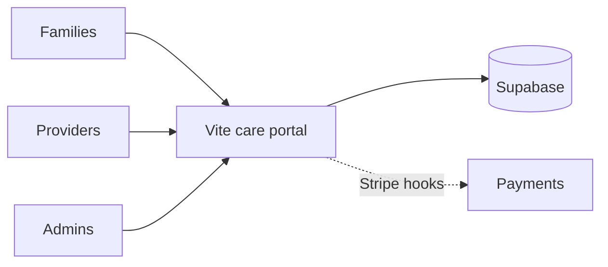

<p align="center">
  
</p>

# HandyHearts Care Tech

**Care-services platform UI for Families, Providers, and Admins, with pricing engine hooks and Stripe + Supabase wiring.**

[](#license)


Vite/React front end plus a small Express server under `server/`. Includes family, provider, and admin portals and a service-request wizard. Stock AI Studio README was replaced.


## How it works



Multi-role care-services UI with pricing-engine hooks. Supabase + Stripe wiring present; treat as product UI / prototype unless a live deploy is confirmed.

## Features

- Multi-role portals (Family, Provider, Admin)
- Deterministic pricing engine module (`domain/pricingEngine.ts`)
- Stripe and Supabase client stubs
- Separate Express server for Stripe webhook / JWT

## Tech stack

- Vite + React + TypeScript
- Tailwind CSS
- Supabase JS
- Stripe
- Optional @google/genai
- Express server

## How to run

```bash
npm install
npm run dev
```

Server:
```bash
cd server && npm install && npm start
```

Set server env from `server/.env.example` (names only: `STRIPE_SECRET_KEY`, `STRIPE_WEBHOOK_SECRET`, `JWT_SECRET`, `PORT`). Front-end Gemini key goes in `.env.local` as `GEMINI_API_KEY` if used.

## Environment variables

Names only. Never commit values.

- `GEMINI_API_KEY`
- `STRIPE_SECRET_KEY`
- `STRIPE_WEBHOOK_SECRET`
- `JWT_SECRET`
- `PORT`

## Status

Public. Early platform scaffold. Not production-hardened.

## License

All rights reserved.
