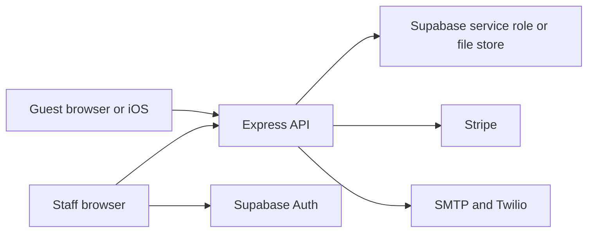

# Technical requirements

- Project: HandyHearts Care Tech
- Document title: Technical requirements
- Document ID: HH-TRD
- Version: 1.0
- Status: Final (as shipped)
- Date last updated: 2026-10-21 (UTC)
- Author: Cursor cloud agent, for Dondon (owner)
- Repository: https://github.com/Awkward8787/Handy-Hearts-Care-Tech
- Commit described: `d0bdd0c2d4d18144129d93fd37faf5033f96c98f`
- Live URL: none. Intended origin in the repo: `https://hhcaretech.com`.

## Contents

1. [Architecture overview](#architecture-overview)
2. [Tech stack](#tech-stack)
3. [Repository structure](#repository-structure)
4. [Environments](#environments)
5. [Configuration and secrets](#configuration-and-secrets)
6. [Third-party integrations](#third-party-integrations)
7. [Security](#security)
8. [Privacy implementation](#privacy-implementation)
9. [Performance](#performance)
10. [Accessibility implementation](#accessibility-implementation)
11. [SEO and sharing](#seo-and-sharing)
12. [Build and deploy](#build-and-deploy)
13. [Testing](#testing)
14. [Monitoring and logging](#monitoring-and-logging)
15. [Browser and device support](#browser-and-device-support)
16. [Technical debt](#technical-debt)
17. [Glossary](#glossary)
18. [Open questions](#open-questions)
19. [Changelog](#changelog)
20. [Sources](#sources)

## Architecture overview

The browser and the iOS app call an Express API. Guest writes do not check a session. Staff calls send a Supabase access token. The API writes guest rows with the Supabase service role, or with a JSON file in development. Stripe, SMTP, and Twilio are optional.



Caption: A guest reaches the API directly. Staff sign-in is the only path that uses Supabase Auth.

A consultation request is validated by `GuestRequest.consultation`, stored, and answered with a receipt. A booking is quoted by `QuoteBuilder.build` before it is stored. Payment status becomes `paid` only when Stripe sends `payment_intent.succeeded` and the amount matches.

## Tech stack

| Layer | Technology | Version observed | Why | Alternative not used |
| --- | --- | --- | --- | --- |
| Language | TypeScript | 5.9.3 | Already in the repo | Plain JavaScript |
| Web UI | React | 19.3.1 | Already in the repo | A second framework |
| Styling | Tailwind CSS | 3.4.19 | Already in the repo | A CSS-in-JS runtime |
| Font | Inter via `@fontsource/inter` | 5.3.0 | Self-hosted, SIL OFL | A Google Fonts request |
| Build | Vite | 6.4.5 | Already in the repo | Webpack |
| Tests | Vitest | 3.2.7 | Node and jsdom | Jest |
| Lint | ESLint | 9.39.5 | Flat config | A disabled rule set |
| Server | Express | 5.3.0 | Small HTTP API | A second host framework |
| Server bundle | esbuild | 0.25.12 | One file for `node dist/index.js` | `tsx` in production |
| Database | Supabase Postgres | Client `@supabase/supabase-js` 2.118.0 | Staff auth already pointed at Supabase | A new database product |
| Payments | Stripe Node | 18.5.0, API `2025-08-27.basil` | Card payments for real-world services | In-app purchase |
| Web cards | `@stripe/stripe-js` | 7.10.0 | Payment Element | A card form we would store |
| Email | nodemailer | 7.0.13 | SMTP when configured | A hard-coded provider |
| Text | Twilio REST | HTTPS `2010-04-01` | SMS when configured | A second SMS vendor in code |
| iOS | SwiftUI, StripePaymentSheet | Package 26.14.0 exact | Same guest API | A second pricing engine on device |
| Node | 22 | `.nvmrc` is 22. This machine ran 22.23.3 | CI image | Node 18 |

## Repository structure

| Path | Role |
| --- | --- |
| `App.tsx` | Route shell. No Supabase call on load. |
| `web/pages` | Home, services, consult, book, receipt, legal, staff |
| `web/routing.ts` | Path matching and `history.pushState` |
| `domain` | Validation, pricing, references, copy |
| `types/guest.ts` | Guest records. No customer user id. |
| `server/createApp.ts` | HTTP routes |
| `server/index.ts` | Process entry, driver choice, static files |
| `supabase/migrations/20261021000000_guest_records.sql` | Tables and the signup trigger |
| `ios/HandyHearts` | SwiftUI guest flows and internal staff sign-in |
| `public` | Favicon, Open Graph image, robots, sitemap |
| `docs` | These documents |

## Environments

| Environment | URL | How it runs | Difference |
| --- | --- | --- | --- |
| Local web | `http://localhost:5173` | `npm run dev` | Vite proxies `/api` to port 3000 |
| Local API | `http://localhost:3000` | `npm run dev:server` | File store unless Supabase keys are set. Rate limit is on in `server/index.ts`. Tests pass `rateLimit: false`. |
| Production process | Not deployed | `npm run build && npm run build:server && npm start` | `NODE_ENV=production` without Supabase and without `DATA_DRIVER=file` refuses guest writes |
| Staging | None | Not applicable | No staging URL was provided |
| Live site | None from this repo | Not deployed | `https://hhcaretech.com` is the canonical origin written into HTML |

## Configuration and secrets

Values are never listed. Rotation means replacing the value in the host’s secret store and restarting the process. The owner holds the accounts.

| Name | Purpose | Required | Default | Read |
| --- | --- | --- | --- | --- |
| `VITE_SUPABASE_URL` | Staff sign-in | Optional for guests | empty | `lib/publicConfig.ts` line 5 |
| `VITE_SUPABASE_ANON_KEY` | Staff sign-in | Optional for guests | empty | `lib/publicConfig.ts` line 9 |
| `VITE_STRIPE_PUBLISHABLE_KEY` | Card element | Optional | empty | `lib/publicConfig.ts` line 13 |
| `VITE_API_BASE_URL` | API origin | Optional | empty, same origin | `lib/publicConfig.ts` line 17 |
| `VITE_BUSINESS_TIMEZONE` | Same-day and weekend | Optional | `UTC` | `lib/publicConfig.ts` line 21 |
| `VITE_PUBLIC_SITE_URL` | Canonical origin | Optional | `https://hhcaretech.com` | `lib/publicConfig.ts` line 26 |
| `PORT` | Listen port | Optional | 3000 | `server/index.ts` line 62 |
| `CORS_ORIGINS` | Allowed origins | Optional | `http://localhost:5173` | `server/index.ts` line 47 |
| `TRUST_PROXY` | Client IP behind a proxy | Optional | off unless `true` or `1` | `server/index.ts` line 48 |
| `BUSINESS_TIMEZONE` | Same as the web zone | Optional | `UTC` | `server/index.ts` line 36 |
| `PUBLIC_SITE_URL` | Payout return URL | Required for payout links | `https://hhcaretech.com` | `server/index.ts` line 49 |
| `DATA_DRIVER` | `supabase` or `file` | Optional | Supabase if keys exist, else file outside production | `server/index.ts` line 26 |
| `SUPABASE_URL` | Auth and store | Required for staff and for the hosted store | empty | `server/index.ts` line 24 |
| `SUPABASE_ANON_KEY` | Verify staff tokens | Required for staff | empty | `server/index.ts` line 42 |
| `SUPABASE_SERVICE_ROLE_KEY` | Server writes | Required for the hosted store | empty | `server/index.ts` line 25 |
| `STRIPE_SECRET_KEY` | PaymentIntents | Required to charge | empty | `server/index.ts` line 43 |
| `STRIPE_WEBHOOK_SECRET` | Verify notices | Required to mark paid | empty | `server/index.ts` line 43 |
| `STRIPE_CONNECT_COUNTRY` | Connect country | Required for payout links | empty | `server/index.ts` line 50 |
| `SMTP_HOST`, `SMTP_PORT`, `SMTP_FROM` | Email | All three required to send | empty. No default port | `server/confirmationSender.ts` line 20 |
| `SMTP_USER`, `SMTP_PASS` | SMTP auth | Optional | empty | `server/confirmationSender.ts` |
| `TWILIO_ACCOUNT_SID`, `TWILIO_AUTH_TOKEN`, `TWILIO_FROM` | Text | All three required to send | empty | `server/confirmationSender.ts` line 24 |

iOS reads `API_BASE_URL`, `STRIPE_PUBLISHABLE_KEY`, `SUPABASE_URL`, `SUPABASE_ANON_KEY`, and `BUSINESS_TIMEZONE` from `ios/Config.example.xcconfig` through `Info.plist`. Local overrides belong in `ios/Config.local.xcconfig`, which is gitignored.

## Third-party integrations

| Service | Use | Auth | Failure |
| --- | --- | --- | --- |
| Supabase Auth | Staff password sign-in and provider apply | Anon key in the browser | Staff page says sign-in is unavailable. Guest pages do not call it. |
| Supabase Postgres | Guest rows and `app_user` | Service role on the server | Guest POST returns 503 with “That request could not be saved. Please try again.” |
| Stripe | PaymentIntent, automatic capture, webhook, Connect account link | Secret key. Webhook signing secret. API version `2025-08-27.basil` in `server/payments.ts` line 43 | Booking is still saved. `clientSecret` stays null. Connect returns “Payout setup is not available right now.” |
| SMTP | Email body is the receipt summary | Host, port, from, optional user | Status `queued` if unset, `failed` if send throws |
| Twilio | SMS, E.164 only | Account SID and token, HTTP Basic | Status `failed` when the number has no leading `+` and Twilio is configured |

No analytics vendor is called.

## Security

Guest routes do not read an Authorization header. Staff routes require `Bearer` and `supabase.auth.getUser`, then a service-role read of `app_user`. The role must be `ADMIN` or `PROVIDER`. Signup metadata cannot insert `ADMIN`. The SQL trigger inserts a provider only when metadata role is `PROVIDER`, with `is_approved` false.

Validation limits are in `domain/fieldLimits.ts`: name 120, email 254, phone 10–15 digits, address 500, notes 2000. Service descriptions on create are capped at 500 characters and minimum hours must be greater than 0 and at most 24.

CORS allows a missing Origin and the configured list. It does not allow `*`.

Rate limits, production only: 15-minute window, 30 guest POSTs, 60 receipt GETs, 120 staff requests. The 429 body is “Too many requests. Please wait and try again.”

Helmet content security policy directives from `server/securityPolicy.ts`:

- `default-src 'self'`
- `base-uri 'self'`
- `form-action 'self'`
- `frame-ancestors 'none'`
- `object-src 'none'`
- `script-src 'self' https://js.stripe.com`
- `style-src 'self' 'unsafe-inline'`
- `img-src 'self' data:`
- `font-src 'self'`
- `connect-src 'self' https://*.supabase.co wss://*.supabase.co https://api.stripe.com`
- `frame-src https://js.stripe.com https://hooks.stripe.com`
- `upgrade-insecure-requests`

`crossOriginEmbedderPolicy` is false. Referrer policy is `strict-origin-when-cross-origin`. Frames are denied. `X-Powered-By` is disabled. HSTS max-age is 15552000, includeSubDomains false, preload false.

`lib/repoHygiene.test.ts` fails the build if a live or test Stripe key prefix, a webhook secret prefix, the removed assistant package, or the removed customer backdoor appears outside tests, docs, and the lockfile. `server/serverLog.ts` redacts secrets by composing prefixes so the source file does not contain those literals.

JSON bodies are limited to 32kb. The error handler returns “Something went wrong. Please try again.” and logs the error name only.

`npm audit` reported 11 issues at install time and was not force-fixed. That is recorded as debt, not silenced.

## Privacy implementation

Collected for a guest: name, email and/or phone, topic or service, preferred date and time, notes, address for in-home visits, price lines, payment status, and confirmation destinations. Stored in `consultation_request`, `service_order`, `confirmation_message`, and `payment`, or in `server/data/store.json` for the file driver. There is no customer user id.

The browser does not write those records to `localStorage`. Supabase staff auth may persist its own session in the browser storage that `@supabase/supabase-js` uses, and only after `/staff` is opened with keys configured. The iOS staff token is in the keychain.

Retention is “until the operator deletes them.” A period is UNCONFIRMED. The privacy page says the software does not include a feature that sells personal information. A lawyer has not reviewed the page.

## Performance

Production build on 2026-10-21, after booking and staff were split out of the main chunk in the working tree:

| Asset | Bytes |
| --- | --- |
| `dist/assets/index-BSBoAUzG.js` | 255285 |
| `dist/assets/BookPage-FmQz9Z57.js` | 20041 |
| `dist/assets/StaffPage-BEoaBWpR.js` | 237887 |
| `dist/assets/index-UXczGig8.css` | 25364 |

Static files from `server/index.ts` use `maxAge: '1h'`. There is no CDN configuration in the repo. Inter is self-hosted as woff and woff2. The Open Graph image is a 1200 by 630 PNG.

## Accessibility implementation

`index.html` sets `lang="en"`. The shell has a skip link to `#main`. Header and footer are `nav` elements with names. Form errors use `role="alert"` in `web/components/Field.tsx`. The receipt lookup and pages use real labels. Focus-visible is a 3px blue outline with a 3px offset. Buttons are at least 44px tall. Reduced motion is honored. The color scheme is forced light. `#10b981` is not used as text on white. There is no dark theme.

## SEO and sharing

`lib/documentMeta.ts` sets the title and description per route. Staff, receipt, receipt lookup, and not-found are `noindex`. The canonical link uses `VITE_PUBLIC_SITE_URL` or `https://hhcaretech.com`. `index.html` includes Open Graph and Twitter tags pointing at `/og.png`. `public/sitemap.xml` lists `/`, `/services`, `/consult`, `/book`, `/privacy`, and `/terms` with lastmod `2026-10-21`. `public/robots.txt` disallows `/staff` and `/receipt`. There is no JSON-LD script, because the content security policy does not allow inline scripts.

## Build and deploy

```bash
npm ci
npm run typecheck
npm run lint
npm test
npm run build
npm run build:server
npm start
```

Node 22. `npm test` also runs `node scripts/check-ios.mjs`. The iOS compile command is in the README and was not run here. Deploy steps that need a host account are not in this repo. Rollback is redeploying the previous git revision and restarting the process. Cache purge depends on the host and is UNCONFIRMED.

## Testing

| File | Asserts |
| --- | --- |
| `domain/guest.test.ts` | Reference alphabet, contact rules, confirmation copy |
| `domain/pricingEngine.test.ts` | Weekend, same-day, and emergency amounts |
| `server/guest.api.test.ts` | Guest consultation and order without auth, unpriced booking, validation, staff 401, CSP |
| `web/guestHome.test.tsx` | Home, consult, and book render with no sign-in and no create-account |
| `lib/repoHygiene.test.ts` | Removed secrets and the AI Studio package are absent |
| `scripts/check-ios.mjs` | Bundle id, privacy manifest, icon, guest copy |

Manual check on 2026-10-21: desktop and mobile guest consultation and guest booking against the file store. iOS Simulator was not available on this Linux machine.

## Monitoring and logging

`ServerLog` writes info and error lines. It does not log request bodies. Webhook and payment failures log a fixed sentence. There is no uptime check and no log drain in the repo. `GET /api/health` returns `status`, `guestStore`, `staffSignIn`, `payments`, `email`, and `text`.

## Browser and device support

| Client | Status |
| --- | --- |
| Chromium on Linux, desktop 1440 by 900 and mobile 390 by 844 | Exercised on 2026-10-21 |
| Safari, Firefox | Not separately exercised. The CSS is standard. UNCONFIRMED. |
| iOS app | Source checked, not compiled |

## Technical debt

| Issue | Severity | Proposed fix |
| --- | --- | --- |
| `saveProviderAccount` replaces `provider_data` with the Stripe account id and `onboardingComplete: false` | Medium | Merge the previous JSON |
| Receipt reference is the only guest secret | Medium | Owner decision on a second factor |
| 11 npm audit findings were not force-upgraded | Low until reviewed | Review each advisory before upgrading past a breaking change |
| Staff chunk is 237,887 bytes because Supabase and the desk load together | Low | Already split from the home page |
| iOS payment errors use the system description | Low | Map card errors the way the web does |

## Glossary

| Term | Meaning |
| --- | --- |
| File store | `server/data/store.json`, used when Supabase is not configured outside production |
| Service role | Supabase key that bypasses row level security. Server only. |
| Anon key | Public Supabase key. Used for staff sign-in, not for guest reads. |

## Open questions

| Question | Owner | Blocked |
| --- | --- | --- |
| Host and TLS for `hhcaretech.com`. UNCONFIRMED. | Dondon | Deploy |
| Log drain and uptime monitor. UNCONFIRMED. | Dondon | Operations |
| Whether to keep the file driver available in production. It works only when `DATA_DRIVER=file`. | Dondon | A production host with no database |

## Changelog

| Date | Version | Change |
| --- | --- | --- |
| 2026-10-21 | 1.0 | Reverse-documented the guest API, headers, and env names. |

## Sources

- `server/index.ts`, `server/createApp.ts`, `server/securityPolicy.ts`, `server/payments.ts`, `server/confirmationSender.ts`
- `package.json`, `server/package.json`, lockfile resolved versions on 2026-10-21
- Production build output on 2026-10-21
