# App flow

- Project: HandyHearts Care Tech
- Document title: App flow
- Document ID: HH-FLOW
- Version: 1.0
- Status: Final (as shipped)
- Date last updated: 2026-10-21 (UTC)
- Author: Cursor cloud agent, for Dondon (owner)
- Repository: https://github.com/Awkward8787/Handy-Hearts-Care-Tech
- Commit described: `d0bdd0c2d4d18144129d93fd37faf5033f96c98f`
- Live URL: none. Flows below were exercised at `http://127.0.0.1:3000` on 2026-10-21.

## Contents

1. [Screen inventory](#screen-inventory)
2. [Navigation model](#navigation-model)
3. [Sitemap diagram](#sitemap-diagram)
4. [User journeys](#user-journeys)
5. [Feature states](#feature-states)
6. [Payment flow](#payment-flow)
7. [Error and edge states](#error-and-edge-states)
8. [Notifications](#notifications)
9. [Screenshots](#screenshots)
10. [Glossary](#glossary)
11. [Open questions](#open-questions)
12. [Changelog](#changelog)
13. [Sources](#sources)

## Screen inventory

| Path | Name | Purpose | Entry | Exit | Account | File |
| --- | --- | --- | --- | --- | --- | --- |
| `/` | Home | Two guest actions | Direct, logo | Consult, book, services | No | `web/pages/HomePage.tsx` |
| `/services` | Services | Five categories | Header Services | Consult, book | No | `web/pages/ServicesPage.tsx` |
| `/consult` | Consultation | Guest form | Header, home card | Receipt | No | `web/pages/ConsultPage.tsx` |
| `/book` | Book | Guest form, review, optional card | Header, home card | Receipt or pay step | No | `web/pages/BookPage.tsx` |
| `/receipt` | Find a receipt | Reference form | Footer | `/receipt/HH-…` | No | `web/pages/ReceiptPage.tsx` |
| `/receipt/:reference` | Receipt | Confirmation the guest keeps | After submit, lookup | Print, home | No | `web/pages/ReceiptPage.tsx` |
| `/privacy` | Privacy | Guest data explanation | Footer | Other footer links | No | `web/pages/LegalPages.tsx` |
| `/terms` | Terms | Price and payment rules | Footer | Other footer links | No | `web/pages/LegalPages.tsx` |
| `/staff` | Staff | Internal sign-in and desk | Footer Staff only | Sign out | Staff only | `web/pages/StaffPage.tsx` |
| other | Not found | Unknown path | Direct | Back to the start | No | `web/pages/LegalPages.tsx` |

iOS uses the same three guest jobs and a Staff link. It has no URL paths. The first screen is `RootView` in `ios/HandyHearts/HandyHeartsApp.swift`.

## Navigation model

The header brand goes to `/`. Header links are Services, Consultation, and Book. There is no Sign in and no Create account in the header. The footer links are Privacy policy, Terms of use, Look up a receipt, and Staff. Links call `Navigation.go`, which uses `pushState` and a `popstate` event, and they still have real `href` values. The browser Back button works because the route state listens for `popstate`. There are no breadcrumbs and no mobile drawer. The 404 heading is “Page not found.” with “Back to the start.”

## Sitemap diagram

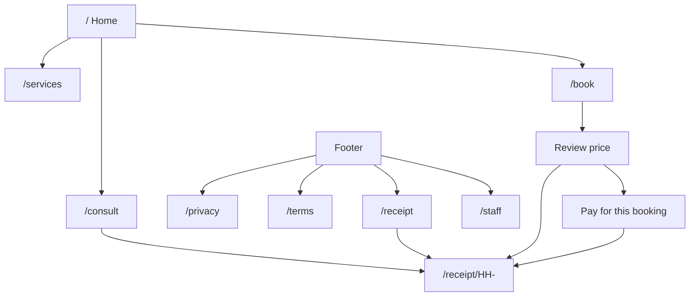

Caption: Guests move from home to a consultation or a booking and land on a receipt. Staff is only in the footer.

The header and footer are on every page, including the receipt. A guest never has to pass through `/staff`.

## User journeys

### FLOW-001 First visit

Trigger: open `/`. Goal: choose consultation or booking.

1. The visitor sees “Request help without creating an account.”
2. They choose the card “Request a consultation” or “Book a service.”
3. No API call is required to see the form.

Success: a form with “No account needed.” Failure: if JavaScript does not run, the server still returns `index.html` for non-API paths, and the page does not render the form. There is no noscript message.

### FLOW-002 Guest consultation

Trigger: the visitor wants to talk before booking. Goal: a receipt. Implements FR-001.

1. Open Consultation.
2. Fill Your name, Email and/or Phone, What do you want to talk about, Preferred date, Preferred time, and optional Anything else.
3. Choose Request consultation.
4. The browser sends `POST /api/consultations` with no Authorization header.
5. The server validates, allocates `HH-` plus 10 characters, stores the row, queues or sends email and text, and returns the receipt.
6. The browser opens `/receipt/:reference`.

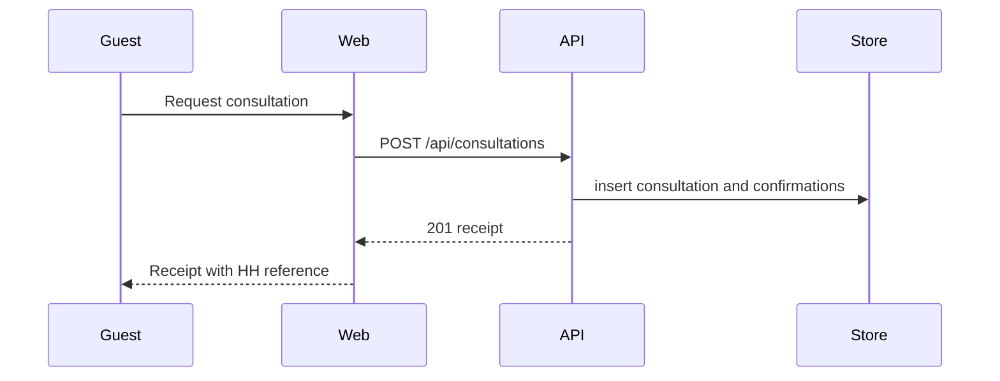

Caption: The consultation sequence has no sign-in step.

Success: the receipt summary names the person, topic, and time. Failure copy is in the error table below. On 2026-10-21 a browser run saved consultation `HH-ZH8SAS2U8S` for the example name Jane Morales. That reference is sample data, not a customer.

### FLOW-003 Guest booking

Trigger: the visitor wants a visit. Goal: a booking receipt. Implements FR-002.

1. Open Book.
2. Choose Service, How soon, Where, Address if in-home, Preferred date, Preferred time, Your name, Email and/or Phone, and optional notes.
3. Choose Review booking. The browser sends `POST /api/quotes`.
4. If no rate matches, the review says “Price to be confirmed. No payment will be taken when you place this booking.”
5. Choose Place booking. The browser sends `POST /api/orders`.
6. If the response has a client secret and a publishable key, the page shows Pay for this booking. Otherwise it opens the receipt.

On 2026-10-21, with an empty service list, booking `HH-WKFAW254X2` was saved for an in-home visit at 100 Example Street. The receipt said the price was to be confirmed and that no payment was taken. No sign-in appeared.

### FLOW-004 Returning with a reference

Trigger: the guest has a reference. Goal: see the receipt again.

1. Footer, Look up a receipt.
2. Enter the reference and choose Show receipt.
3. The browser opens `/receipt/HH-…` and sends `GET /api/receipts/:reference`.

Success: the receipt card. Failure: “That receipt was not found.”

### FLOW-005 Staff

Trigger: a staff member opens the footer Staff link. Goal: work the queue. Guests are not sent here.

1. Sign in with email and password, or apply as a provider.
2. The browser uses Supabase only on this page, then calls `/api/staff/me` with the access token.
3. An admin sees consultations, bookings, assignment, and service rates. A provider sees assigned visits. A pending provider sees “Your provider application is waiting for approval.”

## Feature states

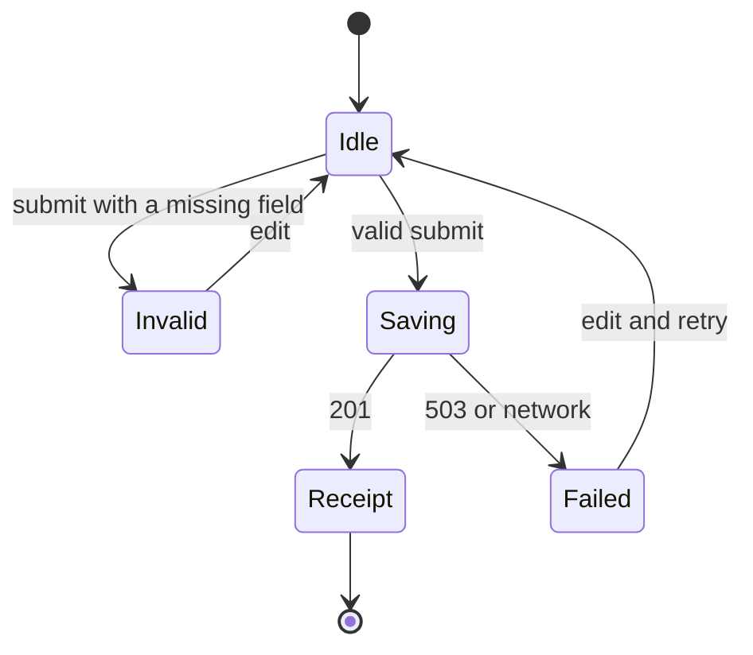

Caption: Consultation and booking share this form state machine. Booking adds a review state before Saving.

Booking urgency radios are Standard, Expedited, and Emergency. Where radios are In-home visit and Remote help. The address field is shown only for in-home. There is no timer and no score. Nothing is written to the browser except the staff session when that page is used.

Visit status for staff, from `domain/visitStatus.ts`: a provider may move `assigned` or `scheduled` to `in_progress` (“Start visit”), then `in_progress` to `completed` (“Mark visit complete”). An admin may set `cancelled` when the visit is not completed or cancelled. Assign sets `assigned`.

## Payment flow

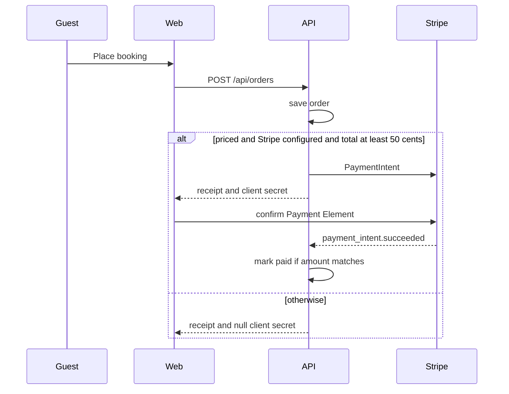

Caption: The booking is saved before any card step. A missing Stripe configuration does not discard the booking.

Card errors of type `card_error` or `validation_error` show Stripe’s message. Other card failures show “The card payment did not go through. No payment was taken.” The return URL is `/receipt/:reference`. The webhook is the writer of `paid`. A mismatched amount returns 500 so Stripe can retry. The idempotency key is `order-${reference}-${amount}`.

## Error and edge states

| Situation | Copy |
| --- | --- |
| Missing name | Enter your name. |
| No email and no phone | Enter an email or a phone number. |
| Bad email | Enter a valid email. |
| Short phone | Enter a phone number with at least 10 digits. |
| Bad service | Choose a service. |
| Past date | Choose a date that is today or later. |
| Date too far | Choose a date within the next two years. |
| In-home without address | Enter the address for an in-home visit. |
| Store down | That request could not be saved. Please try again. |
| Network | HandyHearts can't reach the service right now. Please try again later. |
| Unknown receipt | That receipt was not found. |
| Rate limit | Too many requests. Please wait and try again. |
| Unknown API path | That address was not found. |
| Unknown page | Page not found. |
| Staff auth down | Staff sign-in is unavailable right now. Please try again later. |
| Not staff | This sign-in is for staff. |
| Suspended | This account has been suspended. |

JavaScript disabled: the HTML shell loads and the form does not. Offline: the network sentence above, once the page is open and a request fails.

## Notifications

There are no toasts. Errors are inline. The receipt adds “A confirmation was sent to your email.” only when email status is `sent`, and “A text confirmation was sent to your phone.” only when text status is `sent`. Queued and failed stay off the customer page.

Email subject is `HandyHearts consultation HH-…` or `HandyHearts booking HH-…`. The body is the summary. SMS is the summary trimmed to 320 characters. When delivery is not configured, the stored status is `queued` and the guest still has the receipt.

## Screenshots

Captured 2026-10-21 from the local production server with the file store. Example contact data only.

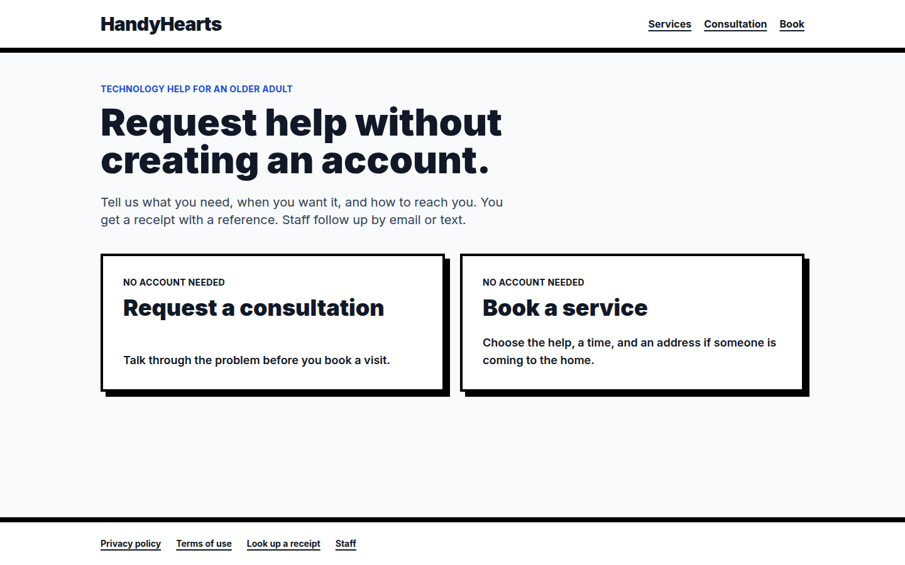

Caption: route `/`, desktop. No account and no sign-in.

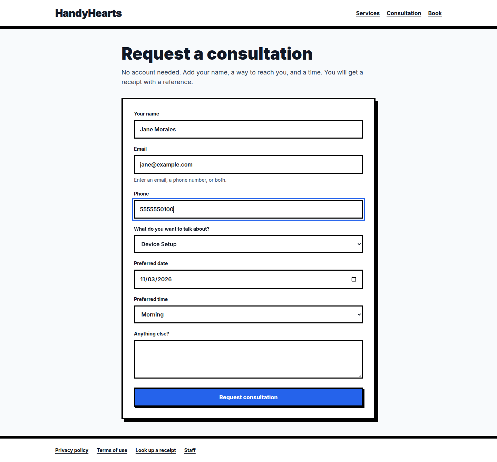

Caption: route `/consult`, desktop, filled and not yet submitted.

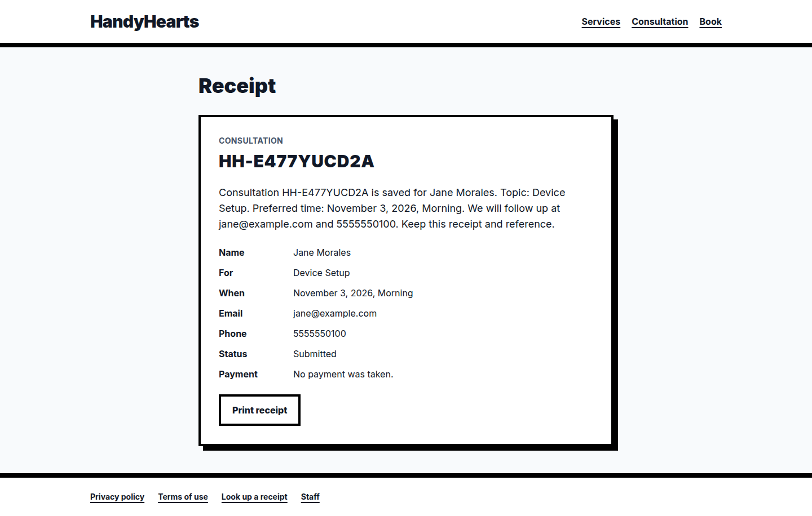

Caption: consultation receipt after submit. Reference shown, no account prompt.

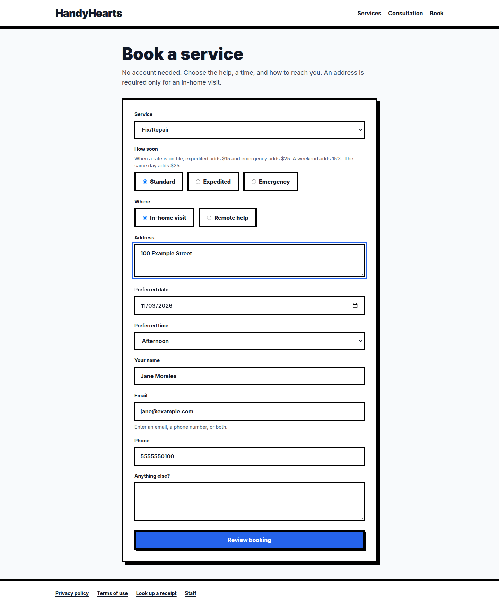

Caption: route `/book`, desktop, in-home address filled.

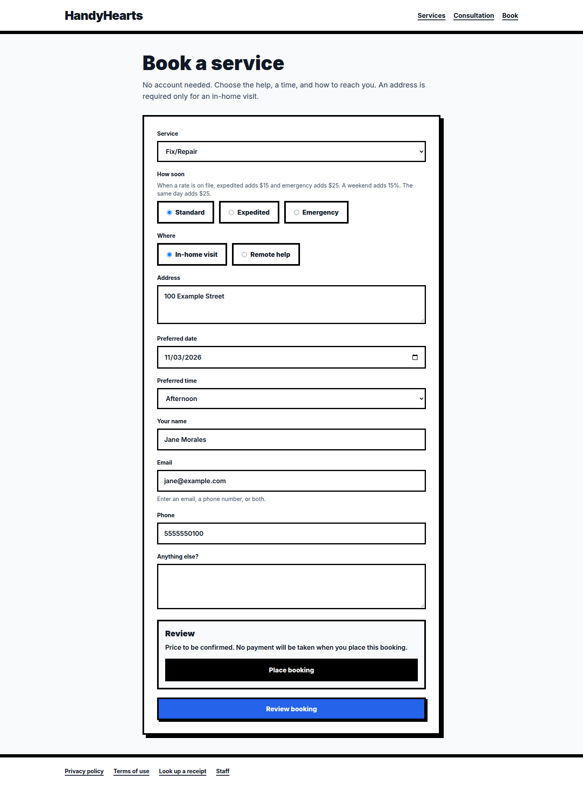

Caption: review states the price is to be confirmed and no payment will be taken.

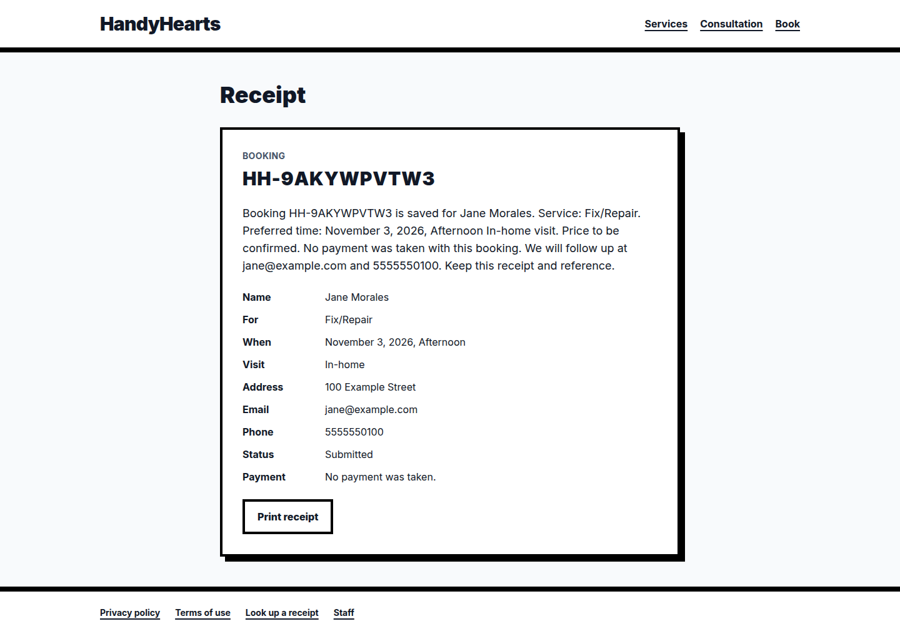

Caption: booking receipt. No payment was taken.

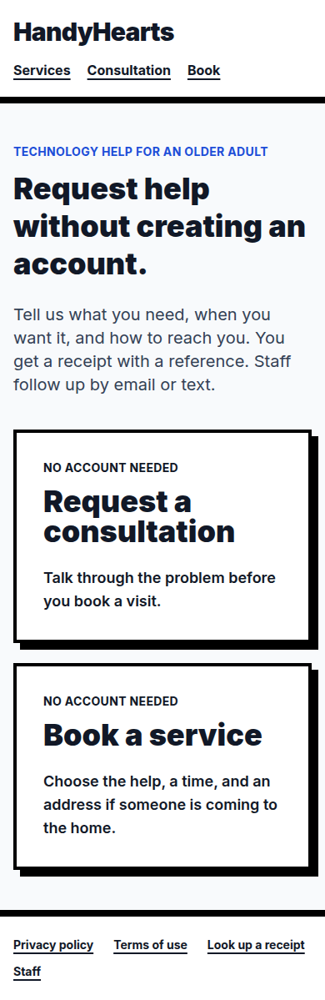

Caption: route `/`, 390px wide.

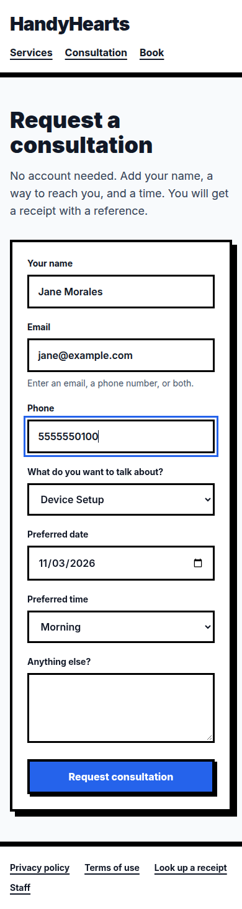

Caption: route `/consult`, 390px wide.

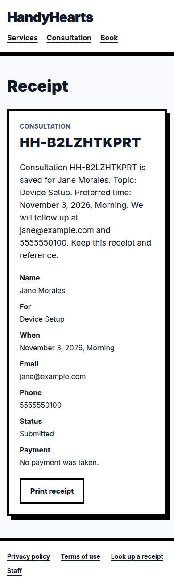

Caption: consultation receipt, 390px wide.

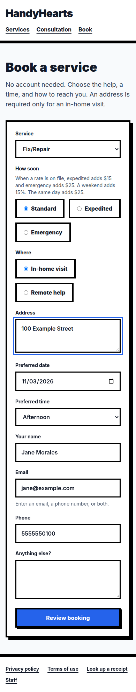

Caption: route `/book`, 390px wide.

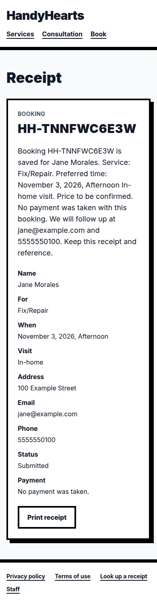

Caption: booking receipt, 390px wide.

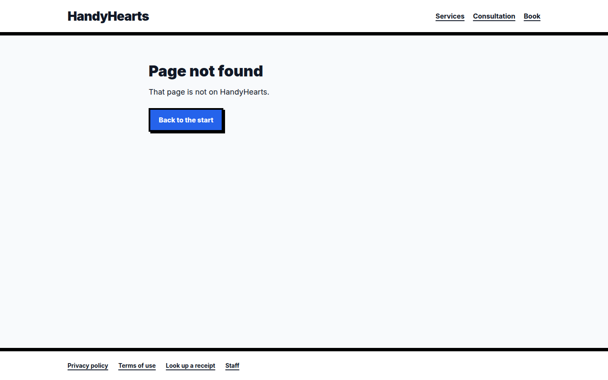

Caption: unknown path.

## Glossary

| Term | Meaning |
| --- | --- |
| Review booking | The button that calls `POST /api/quotes` before the order is saved. |
| Place booking | The button that calls `POST /api/orders`. |
| Staff | Footer link to `/staff`. Not a customer action. |

## Open questions

| Question | Owner | Blocked |
| --- | --- | --- |
| Whether a guest should also receive a printable PDF by email. UNCONFIRMED. The page has Print receipt. | Dondon | Email attachment work |
| iOS screenshots. UNCONFIRMED in this environment because no simulator ran. | Dondon, on a Mac | App Store images |

## Changelog

| Date | Version | Change |
| --- | --- | --- |
| 2026-10-21 | 1.0 | Documented guest consultation and guest purchase as the only customer paths, with screenshots from the local run. |

## Sources

- `web/routing.ts`, `web/components/PublicLayout.tsx`, page components
- Browser session on 2026-10-21, references `HH-ZH8SAS2U8S` and `HH-WKFAW254X2`
- `docs/assets` images from that session
