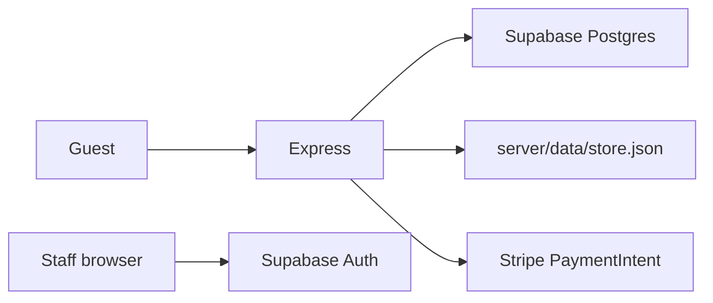
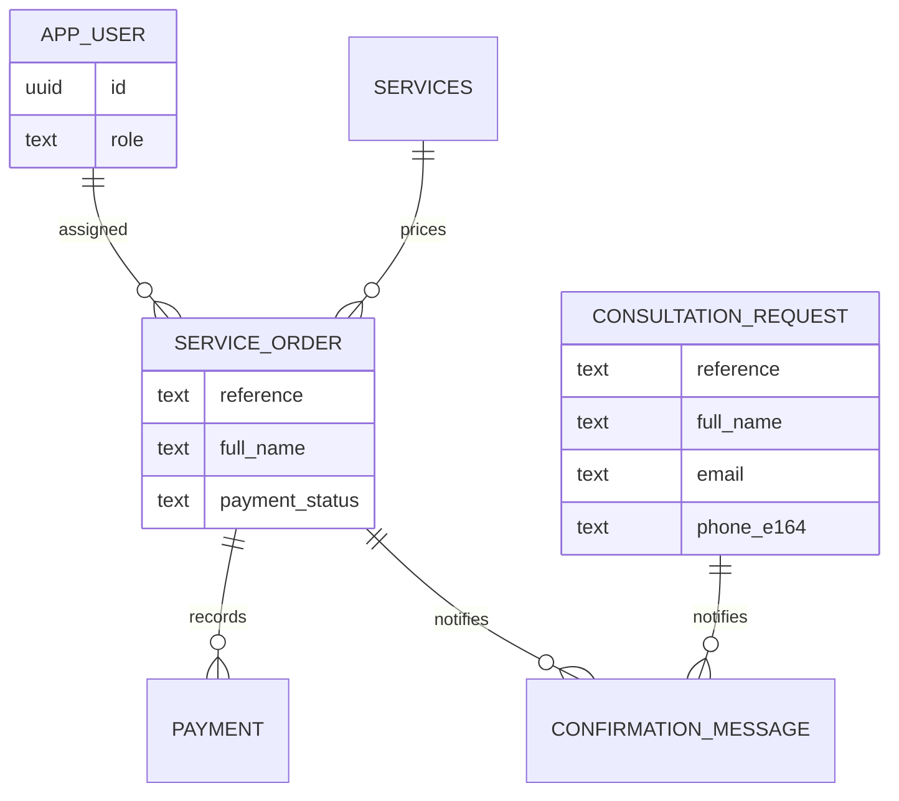

# Backend schema

- Project: HandyHearts Care Tech
- Document title: Backend schema
- Document ID: HH-DATA
- Version: 1.0
- Status: Final (as shipped)
- Date last updated: 2026-10-21 (UTC)
- Author: Cursor cloud agent, for Dondon (owner)
- Repository: https://github.com/Awkward8787/Handy-Hearts-Care-Tech
- Commit described: `d0bdd0c2d4d18144129d93fd37faf5033f96c98f`
- Live URL: none.

## Contents

1. [Data architecture](#data-architecture)
2. [Entity relationship](#entity-relationship)
3. [Tables](#tables)
4. [Client storage](#client-storage)
5. [API reference](#api-reference)
6. [Outbound calls](#outbound-calls)
7. [Webhooks](#webhooks)
8. [Background jobs](#background-jobs)
9. [File storage](#file-storage)
10. [Data lifecycle](#data-lifecycle)
11. [Migrations](#migrations)
12. [Security of data](#security-of-data)
13. [Glossary](#glossary)
14. [Open questions](#open-questions)
15. [Changelog](#changelog)
16. [Sources](#sources)

## Data architecture

Guest consultations and bookings are keyed by an order reference plus the contact details on the row. They are not keyed by a user account. Staff profiles are the only rows tied to `auth.users`.



Caption: The same guest records live in Postgres when the service role is configured, and in a JSON file otherwise, outside production.

The file driver is not a second schema. It stores the same objects as `types/guest.ts`.

## Entity relationship



Caption: Guest tables have no customer user id. A provider assignment is the only user foreign key, and it is nullable.

Confirmation rows point at a reference that may be either a consultation or an order, so the database does not use a single foreign key for that column.

## Tables

Column names are the SQL names. The server maps them to camelCase in `server/supabaseRepository.ts`. Example values are fake.

### app_user

Staff and providers only.

| Field | Type | Null | Default | Constraints | PII |
| --- | --- | --- | --- | --- | --- |
| id | uuid | no | | PK, FK to `auth.users` | yes |
| email | text | yes | | | yes |
| name | text | no | | | yes |
| role | text | no | | `ADMIN` or `PROVIDER` | no |
| is_approved | boolean | no | false | | no |
| is_banned | boolean | no | false | | no |
| phone_e164 | text | yes | | | yes |
| provider_data | jsonb | no | `{}` | Stripe account id lives here | indirect |

### consultation_request

| Field | Type | Null | Default | Constraints | PII |
| --- | --- | --- | --- | --- | --- |
| reference | text | no | | PK, `HH-` plus 10 alphabet characters | no |
| full_name | text | no | | | yes |
| email | text | yes | | contact check with phone | yes |
| phone_e164 | text | yes | | stored as typed-normalized digits, leading `+` kept when present | yes |
| topic | text | no | | catalog id or `unsure` | no |
| preferred_date | text | no | | `YYYY-MM-DD` | no |
| preferred_time | text | no | | anytime, morning, afternoon, evening | no |
| notes | text | yes | | | yes |
| status | text | no | submitted | submitted or closed | no |
| created_at | timestamptz | no | | | no |

There is no `user_id`.

### service_order

| Field | Type | Null | Default | Constraints | PII |
| --- | --- | --- | --- | --- | --- |
| reference | text | no | | PK, same reference pattern | no |
| full_name | text | no | | | yes |
| email | text | yes | | contact check | yes |
| phone_e164 | text | yes | | | yes |
| service_category | text | no | | catalog id, not `unsure` | no |
| service_id | uuid | yes | | FK to `services` when priced | no |
| urgency | text | no | | low, medium, high, emergency | no |
| preferred_date | text | no | | | no |
| preferred_time | text | no | | | no |
| service_type | text | no | | in_home or remote | no |
| address | text | yes | | required by check when in_home | yes |
| notes | text | yes | | | yes |
| total_price_cents | integer | no | | `>= 0` | no |
| price_items | jsonb | no | `[]` | label and amount | no |
| provider_payout_cents | integer | no | 0 | | no |
| platform_fee_cents | integer | no | 0 | | no |
| payment_intent_id | text | yes | | | no |
| payment_status | text | no | | not_due, unpaid, paid | no |
| status | text | no | | draft through cancelled | no |
| assigned_provider_user_id | uuid | yes | | FK `app_user` | yes |
| created_at | timestamptz | no | | | no |
| updated_at | timestamptz | no | | | no |

### confirmation_message

| Field | Type | Null | Notes | PII |
| --- | --- | --- | --- | --- |
| id | bigint identity | no | PK | no |
| reference | text | no | consultation or order reference | no |
| channel | text | no | email or sms | no |
| destination | text | no | email or phone | yes |
| subject | text | yes | email subject | no |
| body | text | no | summary | yes |
| status | text | no | sent, queued, failed | no |
| created_at | timestamptz | no | | no |

Index: `(reference, created_at)`.

### payment

| Field | Type | Null | Notes | PII |
| --- | --- | --- | --- | --- |
| id | text | no | Stripe PaymentIntent id | no |
| reference | text | no | FK to `service_order` | no |
| amount_cents | integer | no | | no |
| status | text | no | only `paid` | no |
| created_at | timestamptz | no | | no |

### services

| Field | Type | Null | Notes | PII |
| --- | --- | --- | --- | --- |
| id | uuid | no | PK | no |
| name | text | no | Must match a catalog label to price a booking | no |
| description | text | no | max 500 on create | no |
| base_rate_cents | integer | no | `>= 0` | no |
| min_hours | numeric | no | `> 0` and `<= 24` | no |
| is_active | boolean | no | default true | no |

No prices are seeded.

## Client storage

| Store | Key | When | Cleared |
| --- | --- | --- | --- |
| Supabase auth storage | The library’s default session key, only after `/staff` with both public env vars set | Staff sign-in | Sign out |
| iOS keychain | service `com.hhcaretech.handyhearts.staff`, account `access-token` | Staff sign-in | Sign out |
| localStorage for guests | none | | |
| Cookies set by this app | none in our code | | |

Guest receipts are not cached in the browser beyond the page.

## API reference

All JSON errors use `{ "error": { "code": "...", "message": "..." } }`. Guest routes do not require Authorization. Implementing file: `server/createApp.ts`.

| ID | Method | Path | Auth | Limit | Effect |
| --- | --- | --- | --- | --- | --- |
| API-001 | GET | `/api/health` | no | none | Flags for store, staff, payments, email, text |
| API-002 | GET | `/api/services` | no | none | Active services, or `[]` if the store is down |
| API-003 | POST | `/api/quotes` | no | 30 / 15 min | Quote only. No write. |
| API-004 | POST | `/api/consultations` | no | 30 / 15 min | 201 `{ receipt }` |
| API-005 | POST | `/api/orders` | no | 30 / 15 min | 201 `{ receipt, clientSecret }` |
| API-006 | GET | `/api/receipts/:reference` | no | 60 / 15 min | `{ receipt }` or 404 |
| API-007 | POST | `/api/stripe/webhook` | Stripe signature | none | Marks paid |
| API-008 | GET | `/api/staff/me` | bearer | 120 / 15 min | Portal name |
| API-009 | GET | `/api/staff/consultations` | admin | 120 | List |
| API-010 | GET | `/api/staff/orders` | staff | 120 | Admin sees all. Provider sees assigned. |
| API-011 | GET | `/api/staff/services` | admin | 120 | List including inactive handling in the repo |
| API-012 | POST | `/api/staff/services` | admin | 120 | Create a rate |
| API-013 | PATCH | `/api/staff/services/:id` | admin | 120 | `{ baseRateCents }` integer |
| API-014 | GET | `/api/staff/providers` | admin | 120 | Approved providers |
| API-015 | POST | `/api/staff/orders/:reference/assign` | admin | 120 | Sets status assigned |
| API-016 | POST | `/api/staff/orders/:reference/status` | staff | 120 | Provider transition or admin cancel |
| API-017 | POST | `/api/staff/consultations/:reference/close` | admin | 120 | Status closed |
| API-018 | POST | `/api/staff/connect-link` | approved provider | 120 | Stripe Connect URL |

Example consultation body:

```json
{
  "fullName": "Jane Morales",
  "email": "jane@example.com",
  "phone": "5555550100",
  "topic": "device_setup",
  "preferredDate": "2026-11-03",
  "preferredTime": "morning",
  "notes": ""
}
```

Example success: `201` and a receipt whose `reference` matches `HH-` plus 10 characters, `emailConfirmation` and `smsConfirmation` of `sent`, `queued`, `failed`, or `skipped`. The body does not include a user id.

Example order adds `serviceCategory`, `urgency`, `serviceType`, and `address`. `clientSecret` is null when payment is not due or Stripe is off.

Validation failures are HTTP 400 with the sentences in HH-FLOW. Store failures are HTTP 503.

## Outbound calls

| Call | When | Mapping |
| --- | --- | --- |
| Stripe PaymentIntent create | Unpaid total `>= 50` and secret set | Amount, currency `usd`, metadata reference, receipt email, idempotency `order-${reference}-${amount}` |
| Stripe account link | Provider payout | Country from `STRIPE_CONNECT_COUNTRY`, return and refresh `PUBLIC_SITE_URL/staff` |
| SMTP send | Email destination and SMTP trio set | Subject and text summary |
| Twilio `Messages.json` | SMS destination starts with `+` and Twilio trio set | To, From, Body |

## Webhooks

Incoming only: `POST /api/stripe/webhook`, raw body, header `stripe-signature`. Event used: `payment_intent.succeeded`. The reference comes from metadata. If the amount does not match `total_price_cents`, the handler returns 500. Duplicate notices upsert the payment id. Other event types return `{ "received": true }` without a write. Unsigned or unconfigured webhooks return 400 or 503 with “The payment notice could not be verified.”

No outgoing webhooks.

## Background jobs

Not applicable. Nothing is scheduled. Confirmations are sent during the request that created the row.

## File storage

`server/data/store.json` holds consultations, orders, confirmations, services, payments, and providers. The directory is gitignored. The path is beside the server package: `data/store.json` when the source is `server/index.ts`, and `../data/store.json` when the bundle is `server/dist/index.js`. There is no object store and no sweep job.

## Data lifecycle

Records stay until the operator deletes them. A retention period is UNCONFIRMED. Backups are the database host’s backups when Supabase is used, and the file itself when the file driver is used. Restore is a host restore or replacing the JSON file. This repo does not configure backups.

Deleting a guest is a SQL delete by reference, or editing the JSON file. There is no self-serve delete button.

## Migrations

Apply `supabase/migrations/20261021000000_guest_records.sql` once, in the owner’s Supabase project. It creates the tables, `is_admin()`, the signup trigger, enables row level security, and revokes anon and authenticated access. It does not insert prices and does not insert an admin.

After the owner creates their auth user, they promote an admin with their own id and email:

```sql
insert into public.app_user (id, email, name, role, is_approved, is_banned)
values ('<auth user uuid>', '<email>', '<name>', 'ADMIN', true, false);
```

Rollback is dropping the tables. Do that only on a database that has not yet stored real guest records.

## Security of data

Row level security is on. Anon and authenticated have no grants on the guest tables or `app_user`. The service role bypasses row level security and is the only writer. Passwords are Supabase’s, not a hash in `app_user`. Guest phones and emails are stored as submitted after normalization, not hashed, because staff must be able to call or write. The receipt reference is unguessable enough for a capability URL and is not a password. Payment card numbers are not stored.

## Glossary

| Term | Meaning |
| --- | --- |
| Reference | Primary key of a consultation or an order |
| not_due | Payment status when the quote total is 0 |
| phone_e164 | Column name. The value is E.164 only when the guest typed a leading plus. |

## Open questions

| Question | Owner | Blocked |
| --- | --- | --- |
| Retention period. UNCONFIRMED. | Dondon | A delete job |
| Platform fee. UNCONFIRMED. Columns exist and are written as 0. | Dondon | Payout math |
| Whether `phone_e164` should reject numbers without `+`. UNCONFIRMED. They are stored and SMS then fails only if Twilio is on. | Dondon | Stricter validation |

## Changelog

| Date | Version | Change |
| --- | --- | --- |
| 2026-10-21 | 1.0 | Guest tables keyed by reference and contact, not by a customer account, matching Dondon’s rule. |

## Sources

- `supabase/migrations/20261021000000_guest_records.sql`
- `types/guest.ts`, `server/supabaseRepository.ts`, `server/fileRepository.ts`, `server/createApp.ts`
- `domain/orderReference.ts`, `domain/phoneNumber.ts`
