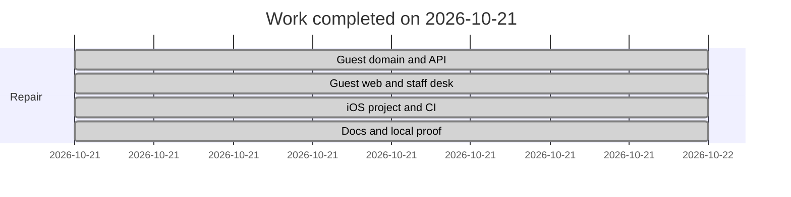

# Implementation plan

- Project: HandyHearts Care Tech
- Document title: Implementation plan
- Document ID: HH-PLAN
- Version: 1.0
- Status: Final (as shipped)
- Date last updated: 2026-10-21 (UTC)
- Author: Cursor cloud agent, for Dondon (owner)
- Repository: https://github.com/Awkward8787/Handy-Hearts-Care-Tech
- Commit described: `d0bdd0c2d4d18144129d93fd37faf5033f96c98f`
- Live URL: none. Not deployed.

## Contents

1. [Delivery summary](#delivery-summary)
2. [Phases](#phases)
3. [Work breakdown](#work-breakdown)
4. [Review gates](#review-gates)
5. [Testing and QA](#testing-and-qa)
6. [Launch checklist](#launch-checklist)
7. [Deployment runbook](#deployment-runbook)
8. [Post-launch owner actions](#post-launch-owner-actions)
9. [Roadmap](#roadmap)
10. [Risks](#risks)
11. [Maintenance](#maintenance)
12. [Glossary](#glossary)
13. [Open questions](#open-questions)
14. [Changelog](#changelog)
15. [Sources](#sources)

## Delivery summary

On 2026-10-21 the repository was repaired so a visitor can request a consultation or book a service without an account, and so the web app, API, and iOS project can be built from documented commands. The work is commit `d0bdd0c2d4d18144129d93fd37faf5033f96c98f` plus the documentation commit that adds this file. Nothing was deployed and no store submission was made.

What was broken before that commit, from the tree at `315e2ce`:

| Problem | What replaced it |
| --- | --- |
| Customer sign-in was required for the family flow, and a public screen could create an administrator | Guest `/consult` and `/book`. Staff sign-in is `/staff` only. SQL refuses admin from signup metadata. |
| A live Stripe publishable key and a Supabase project reference were in client source | Keys come from env names. The old literals are rejected by `lib/repoHygiene.test.ts`. |
| The server start script did not match the TypeScript entry, and CORS was open | `server` workspace builds with esbuild. CORS uses a list. |
| The iOS file was not an Xcode project | `ios/HandyHearts.xcodeproj` with a privacy manifest, icon, and guest screens |
| README and metadata were AI Studio scaffolding | README describes install, env names, and commands |

## Phases

Caption: The repair happened in one working session. Dates are the day of the commit, not an estimate of future effort.

| Phase | Status |
| --- | --- |
| Guest model and API | Shipped in `d0bdd0c` |
| Web guest UI and internal staff | Shipped in `d0bdd0c` |
| iOS source and structural check | Shipped in `d0bdd0c`. Compile not run. |
| Documentation and PDFs | This documentation commit |

## Work breakdown

| ID | Task | Requirement | Status | Notes |
| --- | --- | --- | --- | --- |
| TASK-001 | Guest validation, reference, quote, receipt copy | FR-001, FR-002, FR-003, FR-005 | Shipped | `domain/` |
| TASK-002 | Consultation and order APIs, confirmations, webhook | FR-004, FR-006 | Shipped | `server/createApp.ts` |
| TASK-003 | Guest pages and receipt | FR-001, FR-002, FR-010, FR-012 | Shipped | `web/pages` |
| TASK-004 | Staff desk | FR-007, FR-008, FR-009 | Shipped | `/staff` |
| TASK-005 | SQL migration without a customer user id | FR-001 | Shipped | Owner must apply it |
| TASK-006 | CI typecheck, lint, test, build | NFR-001 | Shipped | `.github/workflows/ci.yml` |
| TASK-007 | iOS guest flows | FR-001, FR-002 | Shipped as source | No simulator here |
| TASK-008 | Icons, sitemap, robots, legal pages | NFR-008, FR-010 | Shipped | |
| TASK-009 | Six documents and PDFs | Documentation pack | Shipped with the docs commit | |
| TASK-010 | Deploy | | Deferred | Owner host |
| TASK-011 | Publish legal identity | FR-010 | Deferred | Owner |

## Review gates

| Review | Date | Verdict | Findings |
| --- | --- | --- | --- |
| Guest rule from Dondon | 2026-10-21 | Accepted and implemented | Customer account removed from the public paths |
| Automated tests | 2026-10-21 | Pass | 23 Vitest tests and `scripts/check-ios.mjs` |
| Browser guest flows | 2026-10-21 | Pass | Consultation `HH-ZH8SAS2U8S` and booking `HH-WKFAW254X2` with no sign-in |
| Accessibility spot check | 2026-10-21 | Pass for shipped pairs | Focus ring, skip link, labels, 44px buttons. Formal audit not commissioned. |
| Security spot check | 2026-10-21 | Pass for the removed secrets | Hygiene test. npm audit findings not force-fixed. |
| iOS compile | | Not run | Linux environment |
| Counsel review of legal pages | | Not done | Owner |

## Testing and QA

Automated: `npm test` on 2026-10-21, 23 tests passed, iOS structure check passed. `npm run typecheck`, `npm run lint`, `npm run build`, and `npm run build:server` passed.

Manual script used in Chromium:

1. Open `/`. Confirm the heading and the absence of Sign in and Create account.
2. Submit a consultation for an example person. Confirm an `HH-` receipt and no account prompt.
3. Submit an in-home booking. Confirm the review says the price is to be confirmed, then the receipt says no payment was taken.
4. Open an unknown path. Confirm “Page not found.”
5. Repeat the home, form, and receipt at 390px width.

Desktop and mobile screenshots are in `docs/assets` and in the pull request artifacts. iOS was not launched.

## Launch checklist

| Item | State | Evidence |
| --- | --- | --- |
| Domain and DNS | Not done | `hhcaretech.com` is written as the canonical origin. Hosting is UNCONFIRMED. |
| TLS | Not done | No deploy |
| Env and secrets | Not done | Example files have empty values |
| Payments live-tested | Not done | Stripe keys are not in this environment. Unpriced booking was tested. |
| Legal pages | Present, identity missing | `web/pages/LegalPages.tsx` |
| Analytics | None by design | No vendor in the client |
| Security headers | Done in code | `server/guest.api.test.ts` checks CSP and HSTS |
| 404 | Done | Browser check |
| Favicon and Open Graph image | Done | `public/` |
| Accessibility spot check | Done | See review gates |
| Backups | Not done | Owner’s database host |
| Monitoring | Not done | Health endpoint only |

Do not launch publicly until the legal identity is on the privacy and terms pages.

## Deployment runbook

This repository does not deploy itself.

1. Apply the SQL migration in the owner’s Supabase project.
2. Promote one admin with that person’s auth user id.
3. Set the server env names and the `VITE_` names. Use the same `BUSINESS_TIMEZONE` on both.
4. On the host: `npm ci`, `npm run build`, `npm run build:server`, `NODE_ENV=production npm start`.
5. Put TLS in front. Set `TRUST_PROXY` if the proxy is trusted. Set `CORS_ORIGINS` to the public origin.
6. Point Stripe’s webhook at `https://<origin>/api/stripe/webhook`.
7. Open `/api/health` and confirm the flags that should be true.
8. Submit one guest consultation and open its receipt.

Rollback: deploy the previous git revision and restart. Database rollback is only safe before real guest rows exist.

iOS: on a Mac, fill `ios/Config.local.xcconfig`, set the team, and run the `xcodebuild` command in the README. Access to Apple and to the host is the owner’s.

## Post-launch owner actions

1. Rotate any Stripe key that was previously committed. Do not reuse it.
2. Confirm which Supabase project is in use. Set the URL, anon key, and service role. Apply the migration.
3. Insert the admin row with the owner’s own email. Do not use a sample address from this document.
4. Choose the IANA time zone and set it on the web and the server.
5. Set `STRIPE_CONNECT_COUNTRY` before provider payout links.
6. Set SMTP and Twilio before email and text can leave the building. Receipts still save without them.
7. Register bundle id `com.hhcaretech.handyhearts` and the Apple team.
8. Publish legal name, mailing address, support email, governing law, and retention period. Have counsel read the pages.
9. Decide the platform-fee split. The code stores 0.
10. Decide whether `hhcaretech.com` is the production host.

## Roadmap

| ID | Task | Depends on | Status |
| --- | --- | --- | --- |
| TASK-201 | Merge existing `provider_data` when saving a Connect account | TASK-004 | Deferred |
| TASK-202 | Structured device notes if the owner wants them back | Owner answer | Deferred |
| TASK-203 | Second factor on receipt lookup if the reference is considered too weak | Owner answer | Deferred |
| TASK-204 | Dark theme | Owner answer | Deferred |

Sizing is not estimated in days.

## Risks

| Risk | Mitigation |
| --- | --- |
| File store used by mistake in production | Production refuses it unless `DATA_DRIVER=file` |
| Guest PII in a screenshot or a local JSON file | `server/data` is gitignored. Docs use the example name only. |
| iOS binary differs from source | Compile on a Mac before submission. The structural check is not a compile. |

## Maintenance

- Update npm dependencies on a cadence the owner chooses. Do not use a force audit fix without reading the advisory.
- Rotate Supabase service role, Stripe secret, webhook secret, SMTP password, and Twilio token if they leak.
- TLS renewal is the host’s.
- Content updates to prices happen in `/staff`, not in a seed file.
- Re-read the legal pages when the operator identity is added, and regenerate these PDFs if the behavior changes.

## Glossary

| Term | Meaning |
| --- | --- |
| File driver | JSON store used for local proof and for non-production without Supabase |
| Owner action | A step that needs an account, a legal fact, or a credential this repo must not invent |

## Open questions

The open questions in HH-PRD, HH-TRD, and HH-DATA remain open. None of them were answered by inventing a value.

## Changelog

| Date | Version | Change |
| --- | --- | --- |
| 2026-10-21 | 1.0 | Recorded the guest repair, the checks that passed, and the owner actions still open. |

## Sources

- Git history: `315e2ce` then `d0bdd0c2d4d18144129d93fd37faf5033f96c98f`
- `npm test` and the production build on 2026-10-21
- Browser guest flows the same day
